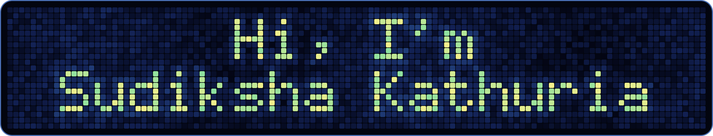

  

Looking for **SDE and ML/DS internships for Summer 2027**.

## About me

I'm a Computer Science Engineering undergraduate at Vellore Institute of Technology, Vellore. I love building things, from small experiments to full products, and I'm happiest when I'm playing around with data. There's something fascinating about taking messy numbers and text and finding the patterns hiding inside them, and then turning that into something people can actually use.

## What I'm working on

- **NLP and LLM reliability:** retrieval-augmented generation, answer verification, and reducing hallucinations in language models
- **Computer vision:** building and training CNN-based models for image tasks
- **Applied ML:** multi-agent LLM pipelines for real-world problems like fraud detection

## Featured projects

| Project | What it does | Stack |
|---|---|---|
| [NoHallucination](https://github.com/sudiksha-kathuria/NoHallucination) | Verifies LLM answers against source documents to catch hallucinated claims | Python, NLP, RAG |
| [FraudNet](https://github.com/sudiksha-kathuria/FraudNet) | Multi-agent LLM platform that analyzes suspected fraud, gives explainable verdicts, and drafts NCRP complaints | React, Flask, Groq (Llama 3.3 70B), EasyOCR, SQLite |
| [HackerHouseRAG](https://github.com/sudiksha-kathuria/HackerHouseRAG) | RAG system built at Hacker House Goa | Python, RAG |
| [Explore: ACM-VIT OCS 2026](https://github.com/sudiksha-kathuria/enrollments-website-26) | ACM-VIT OCS 2026 enrollments website | Next.js, React, TypeScript, Tailwind CSS, Prisma, CockroachDB, Better Auth |
| [ArticleInsights](https://github.com/sudiksha-kathuria/ArticleInsights) | Analysis of editorial content: author productivity, keywords, article length, and sentiment | pandas, NumPy, Matplotlib, Seaborn |

## Tech stack

**Languages** 

**ML and Data Science** 

**Analytics and Visualization** 

**Web and Backend** 

**Databases** 

**Tools** 

## Experience

- **Data Analyst Intern**, Times Network (Times Now), Noida
- **Senior Core Member**, ACM-VIT

## Education

B.Tech Computer Science Engineering, VIT Vellore. CGPA 9.16/10

## Connect

[LinkedIn](https://www.linkedin.com/in/sudiksha-kathuria/) · [Resume](https://drive.google.com/file/d/1PDB8B2CxzIPi0ybonOKiB4KohOJHGlHd/view?usp=drive_link) · [Portfolio](https://sudiksha-psi.vercel.app/) · [Email](mailto:kathuriasudiksha@gmail.com)
