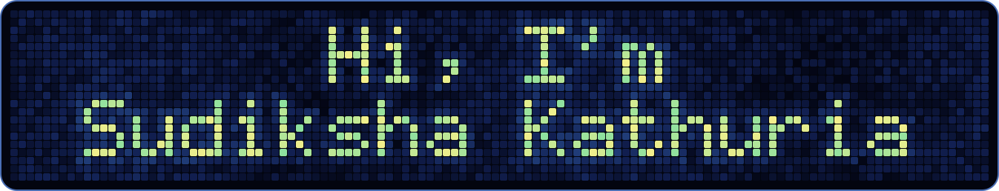

  

Looking for **SDE and ML/DS internships for Summer 2027**.

## About me

I'm a Computer Science Engineering undergraduate at Vellore Institute of Technology, Vellore. I love building things, from small experiments to full products, and I'm happiest when I'm playing around with data. There's something fascinating about taking messy numbers and text and finding the patterns hiding inside them, and then turning that into something people can actually use.

## Featured projects

| Project | What it does | Stack |
|---|---|---|
| [NoHallucination](https://github.com/sudiksha-kathuria/NoHallucination) | Verifies LLM answers against source documents to catch hallucinated claims | Python, NLP, RAG |
| [VirtualFittingRoom](https://github.com/sudiksha-kathuria/virtual-fitting-room) | Real-time virtual try-on that fits clothing and accessories on a live camera feed, using custom-trained CNNs and computer vision | Python, PyTorch, MediaPipe, ONNX, React, FastAPI |
| [ArticleInsights](https://github.com/sudiksha-kathuria/ArticleInsights) | Analysis of editorial content: author productivity, keywords, article length, and sentiment | pandas, NumPy, Matplotlib, Seaborn |
| [Explore: ACM-VIT OCS 2026](https://github.com/sudiksha-kathuria/enrollments-website-26) | ACM-VIT OCS 2026 enrollments website | Next.js, React, TypeScript, Tailwind CSS, Prisma, CockroachDB, Better Auth |
| [EduPulse](https://github.com/sudiksha-kathuria/edupulse-datasets) | Early-warning system that flags students at risk of falling behind using attendance, grades, and engagement, with analysis notebooks, an inference API, and a risk dashboard | Python, scikit-learn, XGBoost, FastAPI, Streamlit |

## Tech stack

**Languages** 

**ML and Data Science** 

**AI** 

**Analytics and Visualization** 

**Web and Backend** 

**Databases** 

**Tools** 

## Experience

- **Data Analyst Intern**, Times Network (Times Now), Noida
- **Secretary**, ACM-VIT

## Education

B.Tech in Computer Science Engineering, VIT Vellore. CGPA 9.16/10

## Connect

[LinkedIn](https://www.linkedin.com/in/sudiksha-kathuria/) · [Resume](https://drive.google.com/file/d/1PDB8B2CxzIPi0ybonOKiB4KohOJHGlHd/view?usp=drive_link) · [Portfolio](https://sudiksha-psi.vercel.app/) · [Email](mailto:kathuriasudiksha@gmail.com)
